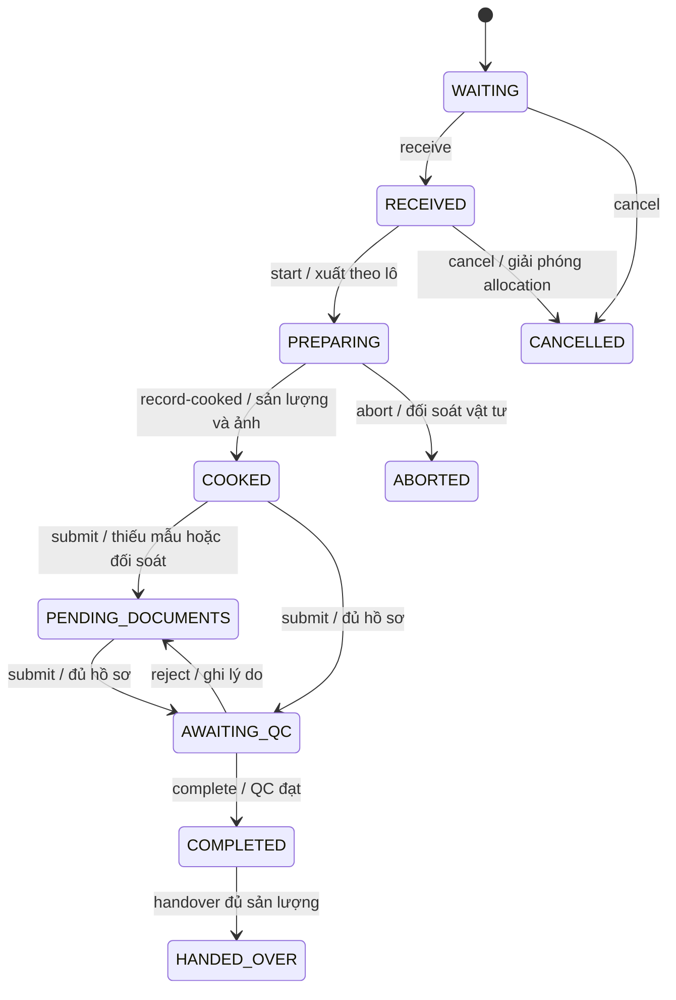

# Thiết kế quản lý bán trú, mẻ chế biến và lưu mẫu

Ngày đối chiếu source: 26/10/2026. Đây là thiết kế triển khai mở rộng; các API và bảng ghi “đề xuất” chưa được triển khai. Phần hiện đã triển khai local gồm filter sản phẩm bán trú và đồng bộ số suất dự kiến khi lưu thực đơn vào kế hoạch DRAFT; bếp trưởng xem món/số suất trong Kế hoạch bán trú. Chi tiết contract và giới hạn nằm trong KITCHEN_TASK_FLOW.md. Chưa triển khai toàn bộ thiết kế mở rộng bên dưới.

## 1. Nền tảng hiện tại và phạm vi mở rộng

Giữ NestJS, TypeORM, PostgreSQL và hai ứng dụng React/Vite hiện tại. Dùng chung kitchen domain, stock movement và upload infrastructure; không tạo service hay inventory ledger thứ hai.

| Thành phần | Source đã đối chiếu | Hiện có / phần cần mở rộng |
|---|---|---|
| Thực đơn phụ huynh | FE_Kido_MBH/src/components/BoardingOrder/BoardingOrderAdmin.jsx | Lịch theo ngày, bữa, khối; tách khỏi số liệu kế hoạch sản xuất |
| Sản phẩm bán trú | src/entities/product.entity.ts | `isBoarding` độc lập `isCanteenItem`; chỉ sản phẩm bật Bán trú mới hiện ở màn bán trú |
| Kế hoạch | src/entities/kitchen.entity.ts; kitchen.service.ts | KitchenMealPlan, khóa kế hoạch sinh batch từ MealItem/đăng ký; thiếu plan item độc lập, revision và phân bổ nhiều mẻ |
| Mẻ | src/entities/kitchen.entity.ts | KitchenProductionBatch có actual/planned/station/version; unique mealPlanId + mealItemId đang giới hạn chia mẻ cùng dòng thực đơn |
| Công việc bếp | kitchen-task.service.ts; kitchen-task.rules.ts | receive/start/record/complete/handover, transaction, version, replay và lô thực tế; cần tách bước hồ sơ/QC |
| Mẫu lưu | kitchen-operations.service.ts | KitchenOperation kind samples; có lượng, đơn vị, vị trí, thời gian; mặc định expectedEndAt thêm 86400000 ms cần thay bằng policy |
| Điều kiện hoàn tất | kitchen-sample.rules.ts | BOARDING luôn cần ảnh; mẫu hiện phụ thuộc requiresSample hoặc lượng >30; thiết kế mới yêu cầu mẫu cho mọi mẻ bán trú theo policy |
| Ảnh | upload.controller.ts; kitchen-task.service.ts | Upload disk, một imageUrl trong details; task complete có thể dùng sample.imageUrl làm ảnh thành phẩm, cần tách hai loại chứng cứ |
| Truy xuất | stock-trace.controller.ts; finished-unit.entity.ts | Lô, supplier và QR từng suất đã có; thêm QR cấp batch mà giữ nguyên QR từng suất |
| Kitchen UI | MBH_Kichen/src/page/portal/OperationsPages.jsx; TaskWorkflowPage.jsx | Có boarding, tasks, samples; mở rộng các màn này |
| Phân quyền | kitchen.controller.ts; kitchen-operations.controller.ts | Một số task/operation role list thiếu HEAD_CHEF dù service có nhánh xử lý; cần đồng bộ guard và service |

Quy tắc sản phẩm: không suy flag Bán trú từ nhóm sản phẩm, không suy từ `isCanteenItem=false`. Việc bỏ flag chỉ ẩn khỏi danh mục/lịch hoạt động; không xóa hồ sơ batch đã tồn tại. Validate lại flag ở backend khi thêm/đổi món của kế hoạch mới.

## 2. Nghiệp vụ và invariant

1. Admin lập ngày/bữa, cơ sở, bếp, bếp trưởng, thời gian bắt đầu/kết thúc, tổng số người ăn và các dòng món. Số suất từng món có thể khác tổng số người ăn.
2. Khi xác nhận, chụp recipe đã duyệt và còn hiệu lực cho từng món; tính định mức và chia mẻ theo năng lực đã cấu hình. Thiếu recipe/policy/phân công hợp lệ thì trả lỗi cụ thể trước khi tạo bất cứ batch nào.
3. Không trừ hoặc giữ tồn kho khi lập/xác nhận kế hoạch. `receive` chỉ xác nhận phân bổ; UI phải nói rõ chưa giữ tồn. `start` kiểm tra tồn/hạn lại và ghi xuất thực tế theo flow hiện tại.
4. Bếp ghi nguyên liệu dùng, hao hụt và lượng trả; nhập sản lượng đạt và ảnh thành phẩm. Bổ sung nguyên liệu phải có movement riêng, không sửa ngược lượng đã xuất.
5. Ghi một hoặc nhiều mẫu theo policy snapshot của batch. Hồ sơ thiếu vẫn lưu được ở trạng thái nháp; chỉ mẫu đã xác nhận đầy đủ mới thỏa điều kiện hoàn thành.
6. Hoàn thành mẻ sau QC; tạo thành phẩm và nhập tồn bếp đúng một lần. Bàn giao là giao dịch tiếp theo, có nơi nhận/người nhận/số lượng.
7. Không sửa/xóa mẻ hoàn thành. Sai lệch sau hoàn thành dùng chứng từ điều chỉnh có lý do, người duyệt và tham chiếu bản gốc.

Định mức: `requiredBaseQty = recipeLineBaseQty × batchPlannedPortions / recipeYieldPortions`. Decimal chính xác theo quy tắc đơn vị, không cộng g với ml. Giữ precision 18,4 hiện có nếu đủ nghiệp vụ; làm tròn nhất quán tại domain boundary. Recipe phải có yield >0. Không tự đổi tỷ lệ hao hụt giữa recipe và ghi thực tế.

Chia 300 suất, công suất 120: tạo 120 + 120 + 60. Tổng suất các batch không hủy phải bằng suất dòng kế hoạch tại revision xác nhận. Không dùng tổng số suất của bốn món để kết luận có 1.200 người ăn.

## 3. Schema đề xuất

Tái sử dụng `kitchen_meal_plans` và `kitchen_production_batches`. Thêm bảng quan hệ cho dữ liệu cần FK, search và audit; JSONB chỉ dùng snapshot, không làm khóa tham chiếu nghiệp vụ.

Quy ước: UUID, created_at/updated_at, actor FK theo User hiện tại; thời điểm dùng timestamptz, ngày phục vụ dùng date theo timezone cơ sở (mặc định Asia/Ho_Chi_Minh). Mọi bảng domain có branch_id; kiểm tra parent-child cùng branch bằng composite FK `(branch_id,id)` có unique tương ứng. `ON DELETE RESTRICT` cho hồ sơ sản xuất, thay quan hệ CASCADE hiện tại theo migration.

| Entity / bảng | Trường chính đề xuất |
|---|---|
| MealPlan / kitchen_meal_plans mở rộng | branch_id, plan_date, meal_period, status, planned_servings, version, current_revision, confirmed_by/at; giữ một plan header mỗi branch/ngày/bữa |
| MealPlanItem / kitchen_meal_plan_items mới | branch_id, meal_plan_id, meal_item_id nullable (nguồn lịch), product_id, planned_portions, station_id, responsible_user_id, planned_start_at, planned_end_at, max_batch_portions, position, active_revision |
| MealPlanRevision / kitchen_meal_plan_revisions mới | branch_id, meal_plan_id, revision, snapshot JSONB, reason, changed_by/at; UNIQUE(plan_id,revision), append-only |
| CookingBatch / kitchen_production_batches mở rộng | branch_id, plan_item_id nullable cho legacy/ticket, batch_code, sequence_no, plan_revision, recipe_id, recipe_snapshot, retention_policy_snapshot, owner_id, planned_start_at/end_at, cooked_at/by, completed_at/by, version; giữ planned_quantity, actual_quantity, station_id và source |
| BatchIngredient / kitchen_batch_ingredients mới | branch_id, batch_id, recipe_line_id, product_id, unit_id, expected_quantity, recipe_snapshot; đây là dòng định mức, không phải một dòng/lô |
| BatchIngredientLot / kitchen_batch_ingredient_lots mới | branch_id, batch_ingredient_id, stock_lot_id, received_quantity, issued_quantity, used_quantity, waste_quantity, returned_quantity; thực tế có thể chia nhiều lô |
| BatchIngredientMovement / kitchen_batch_ingredient_movements mới | branch_id, allocation_id, movement_id FK ledger hiện có, kind ISSUE/SUPPLEMENT/RETURN, quantity, actor/time; nhiều movement trên một allocation |
| BatchImage / kitchen_batch_images mới | branch_id, batch_id, sample_id nullable, storage_key, media_type, byte_size, checksum, purpose FINISHED_PRODUCT/SAMPLE/LABEL, uploaded_by/at, captured_at nullable, voided_by/at/reason |
| FoodRetentionSample / kitchen_food_retention_samples mới | branch_id, batch_id, sample_code, status, quantity, unit_id, sampled_at/by, storage_started_at, storage_location, storage_condition_snapshot, expected_end_at, confirmed_at/by, disposed_at/by/reason, version |
| RetentionPolicy / kitchen_retention_policies mới | branch_id, version, effective_from/to, product_scope, required_sample_count, min_quantity_by_unit, retention_duration_minutes, temperature_min/max, condition_text, requires_sample_photo, requires_label_photo, approved_by/at, source_reference |
| BatchStatusHistory / kitchen_batch_status_history mới | branch_id, batch_id, from_status, to_status, action, actor_id, occurred_at, request_id, reason, batch_version; append-only |
| BatchAuditLog / kitchen_batch_audit_logs mới | branch_id, batch_id nullable, plan_id/sample_id nullable, entity_type/id, action, before/after JSONB, actor_id, request_id, occurred_at, reason; append-only, không log token/secret |
| KitchenCommand / kitchen_commands mới | branch_id, request_id, route/action, fingerprint, response JSONB, actor_id, completed_at; UNIQUE(branch_id,request_id) |
| Distribution / kitchen_batch_distributions mới | branch_id, batch_id, finished_export_id, receiver_place/id, received_by, quantity, handed_over_by/at; dùng chứng từ xuất hiện có, không trừ kho lần hai |

Constraints: planned portions >0; actual portions nguyên >=0; zero-output chuyển xử lý thất bại/hủy có kiểm kê, không hoàn thành như mẻ đạt. Kiểm tra thời gian bắt đầu < hạn hoàn tất; lượng sample >0; expected_end_at > storage_started_at. Lượng issued = used + waste + returned trước QC; thực tế chưa đủ ghi thì hiển thị phần chưa đối soát.

Unique: `(branch_id,batch_code)`, `(plan_item_id,plan_revision,sequence_no)`, `(branch_id,sample_code)`, `(allocation_id,movement_id)`. Bỏ unique `(meal_plan_id,meal_item_id)` và unique manual_line_id khi chuyển sang nhiều batch/line; thay bằng khóa mới cho từng nguồn. Replay dữ liệu ticket/legacy phải còn khóa chống trùng nguồn riêng.

Indexes: batch `(branch_id,status,planned_end_at)`, `(branch_id,plan_item_id)`, plan `(branch_id,plan_date,meal_period)`, ingredient `(branch_id,batch_id)`, allocation `(branch_id,stock_lot_id)`, sample `(branch_id,status,expected_end_at)`, history/audit `(branch_id,batch_id,occurred_at,id)`. Index theo truy vấn thật; dùng EXPLAIN trên volume đại diện trước khi thêm index khác.

Không tạo bảng tenant/school độc lập khi source hiện sử dụng branch scope. Giữ branch là boundary phân quyền; station là bếp trong cơ sở. Nhu cầu tenant quản lý nhiều branch là mở rộng riêng, không cho client tự chọn branch ngoài quyền hiện có.

## 4. State machine

### Kế hoạch

`DRAFT → CONFIRMED → IN_PROGRESS → COMPLETED`; `DRAFT/CONFIRMED → CANCELLED` khi chưa bắt đầu xuất nguyên liệu.

CONFIRMED tương thích ý nghĩa LOCKED hiện tại; dùng adapter cho client cũ trong giai đoạn chuyển tiếp. Điều chỉnh trước chế biến: khóa header và các batch liên quan; yêu cầu chưa receive/start; ghi revision mới, supersede các batch chờ cũ rồi sinh batch mới trong cùng transaction. Nếu đã nhận nguyên liệu phải thu hồi allocation qua action có audit trước. Món đã bắt đầu giữ nguyên snapshot; nhu cầu thêm tạo kế hoạch bổ sung/dòng bổ sung có liên kết nguồn, không đổi batch đang chạy.

### Mẻ



COOKED là “Đã chế biến xong”; PENDING_DOCUMENTS là “Chờ hoàn tất hồ sơ”; AWAITING_QC là “Chờ xác nhận”; COMPLETED là “Hoàn thành”. Receipt/input state của task và trạng thái batch phải có mapping tập trung; không lưu hai nguồn sự thật độc lập. Với task nhiều mẻ, trạng thái task là tổng hợp từ mẻ, không đánh dấu cả task hoàn thành khi còn mẻ thiếu hồ sơ.

Guards complete: PREPARING/WAITING không được gọi trực tiếp; output >0; có FINISHED_PRODUCT image hợp lệ; mọi nguyên liệu đối soát và có movement; đủ sample đã xác nhận theo policy snapshot, ảnh mẫu/nhãn đúng purpose; QC đạt; actor có quyền và version còn khớp. Người/thời điểm xác nhận lấy từ JWT/server. Không yêu cầu chờ kết thúc thời gian lưu mẫu mới hoàn thành batch.

### Mẫu lưu

`DRAFT → COLLECTED → STORED → DISPOSED`. DRAFT biểu diễn “Chưa lấy mẫu”; COLLECTED “Đã lấy mẫu”; STORED “Đang lưu”. “Đủ điều kiện kết thúc lưu” là read projection `status=STORED AND now>=expectedEndAt AND noHold`, tránh cron chậm làm sai điều kiện. Destroy action kiểm tra thời gian lại trong transaction; không tự hủy khi hết giờ. Hold/incident chặn hủy kể cả đã đủ giờ.

Mẫu đã confirmed không PUT ghi đè. `amend` tạo bản điều chỉnh append-only, lý do và người duyệt, giữ toàn bộ bản cũ; thay đổi thời hạn không tự rút ngắn retention. Sample bị void không tính vào completion. Hủy mẫu đúng hạn sau hoàn thành không làm batch mất tính hợp lệ lịch sử; truy xuất hiển thị hồ sơ và ảnh vẫn còn.

Policy không hardcode khối lượng/thời gian/nhiệt độ hay viện dẫn mặc định là quy định pháp luật. Người phụ trách cấu hình và duyệt policy theo quy định đang áp dụng; lưu nguồn và phiên bản. Không có policy hiệu lực thì chặn xác nhận kế hoạch bằng POLICY_NOT_CONFIGURED. Tách hoàn toàn retention expiry khỏi servingExpiresAt của thành phẩm: serving expiry tiếp tục tính từ thời điểm chế biến xong/READY và recommendedUseMinutes snapshot; bổ sung hồ sơ muộn không kéo dài hạn dùng.

## 5. API contract

### API hiện có, giữ tương thích

- `GET/POST /kitchen/meal-plans`, `POST /kitchen/meal-plans/:id/lock`.
- `GET /kitchen/tasks`, `GET /kitchen/tasks/:type/:id`, `POST /kitchen/tasks/:type/:id/:action`.
- `/kitchen/batches/:id/start|ready|complete`, generic `/kitchen/:resource` cho samples/manual-plans và các chứng từ.
- `POST /upload/images` multipart file; hiện trả filename/path/imageUrl, chưa trả media record có scope batch.
- `GET /products?isBoarding=true&displayStatus=active&page=1&size=100`: filter mới của thay đổi hiện tại; frontend đọc đủ trang.

### Contract mới đề xuất

Dùng `/kitchen/v2/...` để không đụng generic controller route hiện có. Khai báo route cụ thể trước catch-all, kiểm tra integration route resolution. Dùng class-validator DTO thay any cho tất cả command. UUID bên dưới là placeholder trong tài liệu.

| Method / path (prefix /kitchen/v2) | Nội dung |
|---|---|
| GET /meal-plans | dateFrom/dateTo, mealPeriod, stationId, status, page/size |
| POST /meal-plans | Header và items; trả id/version/revision/validationIssues |
| GET /meal-plans/:id | Dòng món, định mức, batch, revision và summary |
| PUT /meal-plans/:id | Chỉnh draft với expectedVersion và reason |
| POST /meal-plans/:id/preview | Tính định mức, chia batch, thiếu hụt FEFO; không mutation stock |
| POST /meal-plans/:id/confirm | Khóa/chụp snapshot/tạo batch idempotent |
| POST /meal-plans/:id/revise | Revision trước chế biến theo guards ở trên |
| POST /meal-plans/:id/cancel | Hủy có lý do; không xóa vật lý |
| GET /batches | date, mealPeriod, stationId, productId, status, ownerId, missingImage, missingSample, overdue, page/size |
| GET /batches/:id | aggregate detail, requirements, lots, actuals, images, samples, allowedActions, blockingReasons |
| POST /batches/:id/receive, /start | Chọn lot/quantity và bắt đầu; tái dùng domain task/stock hiện có |
| POST /batches/:id/ingredients/supplement | Xuất bổ sung có reason, lot allocations và movement |
| POST /batches/:id/record-cooked | actualPortions, ingredientActuals, finishedImageIds, varianceReason |
| POST /batches/:id/submit, /complete, /reject | Kiểm hồ sơ, QC đạt hoặc trả lại có lý do |
| POST /batches/:id/cancel, /abort | Cancel trước xuất; abort có đối soát và quyền quản lý |
| POST /batches/:id/handover | destination, recipient, quantity; hỗ trợ nhiều lần nếu tổng không vượt thành phẩm khả dụng |
| GET /batches/:id/history, /trace | Phân trang history; trace aggregate có kiểm branch |
| POST /batches/:id/images | Multipart file, purpose, sampleId optional, expectedVersion, requestId; lưu metadata server |
| POST /batches/:id/samples | Tạo hồ sơ DRAFT, tự điền dish/batch/policy |
| GET /samples, /samples/:id | Lọc ngày, dish, trạng thái, vị trí, đến hạn |
| PUT /samples/:id | Chỉ sửa draft, expectedVersion |
| POST /samples/:id/collect, /store, /confirm | Kiểm dữ liệu và ảnh theo policy |
| POST /samples/:id/amend, /dispose, /hold | Audit bắt buộc, reason, kiểm quyền và thời hạn |
| GET /dashboard | Cùng bộ lọc danh sách batch, snapshotAt và chỉ tiêu toàn bộ tập lọc |
| GET/POST /retention-policies; POST /retention-policies/:id/approve | Quản trị policy có version và thời gian hiệu lực |

Ví dụ tạo kế hoạch:

```json
{
  "requestId": "<UUID>",
  "date": "2026-10-26",
  "mealPeriod": "LUNCH",
  "plannedServings": 300,
  "items": [{
    "productId": "<UUID có isBoarding=true>",
    "plannedPortions": 300,
    "stationId": "<UUID>",
    "responsibleUserId": "<HEAD_CHEF UUID>",
    "plannedStartAt": "2026-10-26T08:00:00+07:00",
    "plannedEndAt": "2026-10-26T10:30:00+07:00",
    "maxBatchPortions": 120
  }]
}
```

Mutation trên aggregate luôn có `{requestId, expectedVersion}`; phiên bản tạo mới không cần expectedVersion. Response đề xuất theo envelope hiện tại, payload `{id,version,status,allowedActions,blockingReasons}`; list `{data,page,size,total}`. Không tự đổi global response interceptor. Error chuẩn hóa payload `{code,message,details,currentVersion}`.

Mã lỗi: PRODUCT_NOT_BOARDING, RECIPE_NOT_APPROVED, POLICY_NOT_CONFIGURED (422); VERSION_CONFLICT, INVALID_TRANSITION, IDEMPOTENCY_KEY_REUSED, STOCK_SHORTAGE, LOT_EXPIRED, ACTUAL_IMAGE_REQUIRED, INGREDIENTS_NOT_RECONCILED, SAMPLE_REQUIRED, SAMPLE_INCOMPLETE, RETENTION_NOT_ELAPSED, SERVING_EXPIRED (409); 403 thiếu quyền, 404 tài nguyên ngoài scope/không tồn tại. UI dùng code thay vì parse message. Các mã mới là đề xuất, không khẳng định đã có trong backend.

## 6. Transaction, phân quyền và file

- Resolve branch từ JWT theo service hiện tại. ADMIN/MANAGER chỉ chọn cơ sở theo quyền được cấp; mọi nested ID, file ID, lot và supplier chain đều kiểm scope. UUID/QR không thay thế authorization.
- ADMIN/MANAGER: tạo/xác nhận kế hoạch, policy, xem báo cáo, điều chỉnh và hủy. HEAD_CHEF: nhận/phân công, chế biến, QC, quản lý mẫu trong bếp/cơ sở được giao. KITCHEN: thao tác nhiệm vụ mình được giao/đã nhận, ghi ảnh/mẫu, submit và bàn giao theo quyền. CASHIER không có command chế biến. KITCHEN không tự duyệt policy hoặc override QC. Mặc định HEAD_CHEF/ADMIN/MANAGER xác nhận hoàn thành; nếu cơ sở cho nhân viên tự QC phải cấu hình quyền riêng.
- Một command = một DB transaction: khóa aggregate, kiểm replay theo requestId+fingerprint+actor/action, kiểm expectedVersion, khóa lot theo thứ tự UUID, kiểm tồn, ghi movement/domain/history/audit/response, commit. Replay cùng request/body trả kết quả đã lưu; requestId trùng khác body/action trả 409. Kiểm quyền hiện tại trước cả replay.
- Complete khóa batch và sample liên quan; xác nhận ảnh đã READY và metadata không bị void; hoàn nguyên liệu thừa, tạo finished units/import/tồn bếp và lịch sử trong cùng transaction. Mọi lối gọi cũ phải qua cùng completion guard, không để ready/complete cũ bypass policy mới.
- Giữ branch lock hiện tại trong giai đoạn đầu để không phá accounting/shift closing; đo contention trước khi thu hẹp lock. Không chuyển dần sang row lock nếu các writer còn lại vẫn dùng semantics khác.
- Upload ngoài DB transaction: ghi file staging bằng storage adapter dùng disk hiện tại; kiểm magic bytes, allowlist JPEG/PNG/WebP, giới hạn dung lượng hiện hành, decode được và tên server sinh. Ghi media metadata READY rồi mới attach vào batch. Cleanup orphan sau khoảng cấu hình; không xóa file đang có audit reference.
- FINISHED_PRODUCT photo và SAMPLE/LABEL photo là các loại riêng; ảnh sản phẩm minh họa không attach làm chứng cứ. Backend chứng minh nguồn upload/loại file/liên kết, không thể tự chứng minh bằng metadata rằng ảnh chụp đúng món hoặc đúng thời điểm; QC chịu trách nhiệm xác nhận nội dung. Không tin capturedAt/EXIF từ client như thời điểm xác nhận.
- Ảnh hồ sơ cần protected read qua authorization; không chỉ dùng public static uploads path. Có thể giữ disk nhưng lưu evidence ngoài static root và stream qua endpoint có guard. Storage key server quyết định; không fetch URL tùy ý từ client. Object storage là adapter có thể bổ sung theo topology triển khai.
- Socket sau commit như hiện tại; nếu yêu cầu delivery bền vững thì transactional outbox và worker retry. Lỗi notification không rollback command đã commit. UI hiện có refresh thủ công; không tự đưa polling/socket vào ngoài phạm vi này.

## 7. Thiết kế màn hình Admin Web

Mở rộng khu vực BoardingOrder và navigation hiện có; các route mới dưới đây là đề xuất. Dùng typography, CustomSelect, modal, toast và ERP layout đang dùng.

| Màn / route đề xuất | Bố cục và hành vi |
|---|---|
| Tổng quan /boarding-production | Bộ lọc ngày/bữa/cơ sở/bếp/món/trạng thái; dải số liệu ngắn; bảng mẻ với hạn hoàn tất, tiến độ và hồ sơ thiếu; bấm số liệu áp dụng filter tương ứng |
| Kế hoạch /boarding-production/plans | Bảng mã/ngày/bữa/số người ăn/số dòng món/số mẻ/bếp trưởng/trạng thái; Tạo, Sao chép ngày, Xem revision; không tự xác nhận khi sao chép |
| Form kế hoạch /plans/new hoặc /plans/:id/edit | Header ngày/bữa/tổng suất; bảng món chỉ isBoarding=true, định mức/recipe status, suất riêng, bếp, người phụ trách, thời hạn/công suất; footer Lưu nháp → Xem trước → Xác nhận |
| Xem trước xác nhận | Hiện chính xác 120/120/60 của mỗi món, tổng nguyên liệu theo đơn vị, khả dụng/thiếu tham khảo và policy; xác nhận ghi transaction, không trừ kho |
| Mẻ /boarding-production/batches | Bảng mã/plan/món/bếp/người làm/dự kiến/thực tế/bắt đầu/hạn/trạng thái/ảnh/mẫu; filter và phân trang server; cảnh báo chậm bằng text + icon |
| Chi tiết /batches/:id | Header mã/QR/status/deadline; tabs Kế hoạch, Nguyên liệu, Thành phẩm & ảnh, Mẫu lưu, Phân phối, Lịch sử; timeline đầy đủ actor/time/reason và diff |
| Mẫu /boarding-production/samples | Bảng mã mẫu/mẻ/món/lượng/vị trí/ngày lấy/hạn lưu/trạng thái; tới hạn, hold, thiếu nhãn; drawer hồ sơ, amendment, điều kiện hủy và history |
| Policy /boarding-production/policies | Version, hiệu lực, phạm vi món, khối lượng/đơn vị, thời gian, điều kiện, ảnh bắt buộc, nguồn quy định; preview và duyệt version mới |

Wireframe form chính: `[Ngày][Bữa][Cơ sở]` → `[Số người ăn]` → bảng `[Món bán trú | Suất món | Recipe | Bếp | Bếp trưởng | Bắt đầu | Hoàn tất | Suất/mẻ]` → `[Tổng nhu cầu nguyên liệu]` → `[Lưu nháp][Xem trước & xác nhận]`.

Dashboard phân biệt `plannedMealServings` (người ăn, đếm plan một lần), `plannedDishPortions` (suất món), `actualDishPortions` (thành phẩm thực tế). Không gắn actualDishPortions nhãn “người đã ăn”. Khi cần số suất ăn đủ bộ, chỉ tính theo cấu hình bộ món/phân phối xác nhận, không lấy min tùy tiện giữa món tự chọn.

Các chỉ tiêu batch: chưa bắt đầu WAITING/RECEIVED; đang chế biến PREPARING; đã nấu COOKED; chờ hồ sơ PENDING_DOCUMENTS; chờ xác nhận AWAITING_QC; hoàn thành COMPLETED/HANDED_OVER. `missingImageCount`, `missingSampleCount` có thể giao nhau; không cộng thành tổng batch. `overdueCount`: chưa COOKED và quá plannedEndAt; theo dõi trễ hoàn thiện hồ sơ bằng SLA riêng để không lẫn trễ chế biến. Aggregate toàn bộ tập lọc, không tính từ trang đang xem.

## 8. Thiết kế màn hình Kitchen Web

Tái sử dụng `/kitchen-plan/boarding`, `/cooking/tracking`, `/samples/manage`, `/samples/history` và TaskWorkflowPage. Bổ sung detail step theo batch thay vì tạo hai danh sách công việc trùng nguồn.

| Màn | Nội dung và thao tác chính |
|---|---|
| Công việc hôm nay | Ngày/bữa/bếp; tabs Của tôi/Chưa nhận/Đang làm/Chờ hồ sơ; mỗi thẻ tên món, mã mẻ, suất, hạn, người phụ trách, cảnh báo và CTA Xem nhiệm vụ |
| Tiếp nhận | Header món + suất; recipe snapshot; bảng nguyên liệu cần/đủ/thiếu; gợi ý lô FEFO (hết hạn trước, không hạn sau, tie-break ngày nhập/id), cho thay lô có lý do; CTA Xác nhận nhận nguyên liệu |
| Chế biến | Thời gian bắt đầu do server; nguyên liệu đã xuất theo lô; ô dùng/hao hụt/trả, note phát sinh; CTA Xuất bổ sung và Ghi nhận đã chế biến xong |
| Thành phẩm & ảnh | Sản lượng thực tế, so sánh dự kiến, bắt buộc lý do sai lệch; nút lớn Chụp ảnh/Tải ảnh; nhiều ảnh có preview/trạng thái upload; CTA Lưu thành phẩm |
| Lưu mẫu | Danh sách mẫu của mẻ, Thêm mẫu; tự điền món/mẻ/người lấy/policy; chỉ nhập khối lượng, vị trí, thời điểm thực nếu khác mặc định, điều kiện thực; chụp ảnh mẫu và nhãn riêng; CTA Xác nhận lưu mẫu |
| Kiểm tra hoàn tất | Checklist số lượng/ảnh/lô/mẫu/QC từ blockingReasons backend; mỗi thiếu sót có liên kết về bước tương ứng; CTA Gửi xác nhận hoặc Xác nhận hoàn thành theo quyền |
| Bàn giao | Số lượng khả dụng còn lại, nơi nhận, người nhận, số giao; hiển thị serving expiry; không giao quá tồn/hết hạn; chứng từ và trace sau commit |

Responsive: từ 1024px danh sách + detail hai cột; tablet một cột detail; mobile nút chính sticky dưới cùng, chừa safe-area. Touch target tối thiểu 44px, input số với inputMode decimal/numeric phù hợp; không dùng màu làm dấu hiệu duy nhất. Ảnh minh họa món đặt nhãn rõ, tách gallery ảnh thực tế.

Mọi màn có loading/empty/error/retry; form giữ dữ liệu khi lỗi mạng. Không báo thành công trước server. Disable submit khi đang gửi; retry dùng lại requestId/body. Version conflict yêu cầu tải dữ liệu mới và hiển thị phần thay đổi, không tự ghi đè hoặc tự đổi expectedVersion. Chưa thiết kế offline mutation vì cần tồn kho/lot/version thời gian thực.

## 9. QR và truy xuất

QR batch chứa namespace/version/UUID, ví dụ `mbh:batch:v1:<uuid>`; không chứa token hoặc thông tin supplier nhạy cảm. Scanner resolve batch và yêu cầu đăng nhập. Giữ `finished_units` QR từng suất như hiện tại; scan suất tìm batch, scan batch mở tổng hồ sơ.

Chuỗi truy xuất: supplier/import voucher → stock lot → stock movement/allocation → batch/recipe snapshot → finished import/finished unit → retention sample → finished export/distribution. Sample và distribution cùng là nhánh liên kết tới batch, không ngụ ý mẫu được đem phân phối. Cho phép truy ngược từ lô tới toàn bộ batch/distribution liên quan để khoanh vùng sự cố. Liên kết thiếu của legacy hiển thị “Chưa có dữ liệu”, không dựng provenance giả.

## 10. Lộ trình triển khai và nghiệm thu

1. Schema additive và backfill: tạo item cho mỗi batch nguồn hiện có, sequence=1; gán branch qua plan; giữ original UUID/QR. Đánh dấu legacy evidence, không tự xác nhận mẫu thiếu. Chạy dry-run đếm/orphan/duplicate trước unique/FK. Đổi CASCADE sang RESTRICT sau khi kiểm dữ liệu.
2. Domain command/state/DTO/role guard, policy snapshot, ảnh typed, samples bất biến và completion guard dùng chung cho các endpoint. Chuyển read/write theo từng nguồn; không dual-write hai ledger.
3. Admin plan/revision/split/preview và Kitchen steps; bật theo branch sau backfill. Giai đoạn migration chặn legacy writer cho batch v2, trả lỗi hướng dẫn thao tác đúng flow.
4. Dashboard SQL/read model, QR/trace, distribution, báo cáo và quan sát contention. Không xóa cột/table JSON cũ cho đến khi đối soát và hết client cũ; rollback ứng dụng giữ schema additive và dữ liệu mới.

Acceptance bắt buộc: hai confirm đồng thời chỉ tạo một tập batch; 300/120 chia đúng 3 mẻ; confirm không đổi stock; hai start tranh một lô không âm tồn; retry không trừ/nhập hai lần; FEFO loại lô hết hạn; thiếu recipe/policy rollback toàn bộ; thiếu ảnh thành phẩm hoặc ảnh chỉ thuộc sample không complete; mọi mẻ BOARDING đều đủ sample theo policy dù <=30; ảnh món mẫu không thỏa evidence; bỏ flag không hiện danh mục bán trú nhưng lịch sử batch còn nguyên; cross-branch IDs bị chặn; HEAD_CHEF thực hiện đúng quyền; không chuyển WAITING thẳng COMPLETED; hủy mẻ đang làm đối soát đủ vật tư; mẫu confirmed chỉ amend có audit; chưa đủ thời gian/hold không dispose; complete muộn không gia hạn thành phẩm; lỗi sau movement rollback cả stock/domain; QR batch và QR từng suất không lẫn; tổng dashboard không nhân số người ăn theo số món.

Đợt sửa filter hiện tại đã build Frontend/Backend và chạy 2 product suites (17 tests) thành công. Đây là bằng chứng local; thiết kế mở rộng, migration, transaction mới và UI mới ở trên cần triển khai và kiểm chứng riêng, chưa có xác nhận runtime/DB/production.
